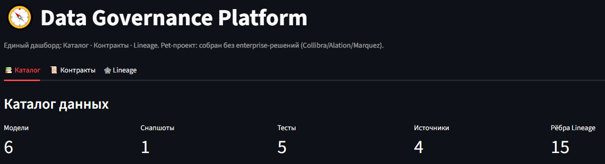
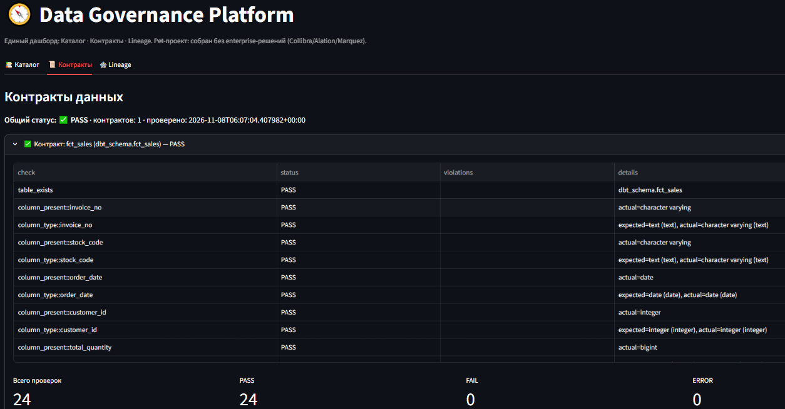
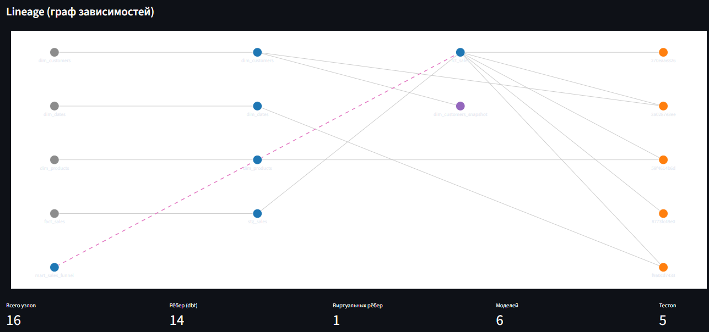

# 🧭 Data Governance Platform

Единый дашборд Data Governance для платформы данных: **Каталог · Контракты · Lineage** — собранный без enterprise-решений (Collibra / Alation / Marquez).

Pet-проект на реальном dbt-манифесте (`marketplace_dwh`, 6 моделей, 1 снапшот, 5 тестов, 4 источника, PostgreSQL).

## 📸 Скриншоты

**Каталог — модели, снапшоты, тесты, источники:**


**Контракты — 24/24 PASS, включая проверку типов:**


**Lineage — граф зависимостей с восстановленным виртуальным ребром (пунктир):**


## 🎯 Зачем это

В реальной компании три вещи — **каталог**, **контракты** и **lineage** — часто живут в разных системах и стоят как чугунный мост. Здесь показано, как собрать их **в одном Streamlit-приложении** из одного `manifest.json` + YAML-файлов контрактов + PostgreSQL.

## 🏗 Архитектура

```
manifest.json (dbt)             contracts/*.yml
        │                              │
        ▼                              ▼
scripts/catalog_generator.py   scripts/contract_validator.py
        │                              │
        ▼                              ▼
   data/catalog.json         data/contract_results.json
        │                              │
        └──────────┬───────────────────┘
                   ▼
          app/streamlit_app.py
        (Каталог · Контракты · Lineage)
```

- **Каталог** — парсит `manifest.json`: модели, снапшоты, тесты, источники. Owner, layer, tags, колонки, depends_on.
- **Контракты** — YAML-описание колонок, типов, NULL-ограничений, primary key, constraints. Валидатор проверяет их **на реальных данных** в PostgreSQL.
- **Lineage** — граф зависимостей из `parent_map` dbt. **Плюс** восстановленные рёбра: если в `raw_code` модели есть `dbt_schema.<name>` или `{{ ref() }}`, не отражённые в `depends_on`, валидатор каталога добавляет виртуальное ребро.

## 📂 Структура

```
data-governance-platform/
├── manifest.json                # dbt manifest (вход)
├── contracts/
│   └── fct_sales.yml            # Data Contract для fct_sales
├── scripts/
│   ├── catalog_generator.py     # manifest → catalog.json
│   └── contract_validator.py    # YAML + PostgreSQL → contract_results.json
├── app/
│   └── streamlit_app.py         # 3 вкладки: Каталог / Контракты / Lineage
├── data/                        # генерируемые артефакты
│   ├── catalog.json
│   └── contract_results.json
├── assets/                      # скриншоты для README
├── requirements.txt
└── README.md
```

## 🚀 Запуск

```bash
# 1. зависимости
pip install -r requirements.txt

# 2. собрать каталог из manifest.json
python scripts/catalog_generator.py
# → data/catalog.json

# 3. проверить контракты на реальных данных
python scripts/contract_validator.py
# → data/contract_results.json + exit-code 0 при PASS

# 4. запустить дашборд
streamlit run app/streamlit_app.py
# → http://localhost:8501
```

**Требования:** Python 3.10+, PostgreSQL с базой `dwh_marketplace` (см. `scripts/contract_validator.py` — параметры подключения `localhost:5432`).

## 🔍 Что нашли (Data Quality инциденты)

Контракт — не формальность. При первом прогоне он **выявил 2 расхождения** между объявленной и фактической схемой `dbt_schema.fct_sales`:

| Колонка | Объявлено в контракте | Фактически в БД | Итог |
|---|---|---|---|
| `customer_id` | `text` (правило `length() > 0`) | `integer` | ❌ `length(integer)` не существует |
| `total_quantity` | `numeric` | `bigint` (целое) | ❌ тип не совпал |

После правки контракта (`customer_id: integer`, `total_quantity: integer`) — **все 24/24 проверки проходят**.

Это ровно то, ради чего Data Contracts нужны: **контракт не дрейфует незаметно**. Добавлена проверка `column_type::<col>` — она сравнивает ожидаемый тип с `information_schema`.

## 🕸 Lineage: восстановленное ребро

`mart_sales_funnel` читает `fct_sales` через **raw SQL** (`FROM dbt_schema.fct_sales`), а не через `{{ ref('fct_sales') }}`. dbt такую связь **не видит** (`parent_map` пустой для этой модели). Каталог-генератор парсит `raw_code` и **восстанавливает виртуальное ребро** `fct_sales → mart_sales_funnel`. На графе оно отрисовано пунктиром.

## 🛠 Стек

- **Python** — psycopg2, PyYAML, pandas
- **dbt** — источник манифеста (1.12.6, adapter `postgres`)
- **PostgreSQL** — реальная проверка контрактов (`dwh_marketplace.dbt_schema.fct_sales`)
- **Streamlit** — дашборд
- **Plotly** — граф Lineage
- **GitHub Actions** (в планах) — запуск валидатора в CI

## 📊 Результаты

- Каталог: **6 моделей, 1 снапшот, 5 тестов, 4 источника, 15 рёбер** (14 dbt + 1 виртуальное).
- Контракты: **24/24 PASS** после исправления двух типов.
- Lineage: **14 рёбер из `parent_map` + 1 восстановленное** (`fct_sales → mart_sales_funnel`).

## 🔗 Связанные проекты

- [`marketplace-dwh-analytics`](https://github.com/nconichtchenko-arch/marketplace-dwh-analytics) — DWH, из которого взят manifest.
- [`dbt-data-lineage-demo`](https://github.com/nconichtchenko-arch/dbt-data-lineage-demo) — визуализация Lineage для dbt (Streamlit + NetworkX).
- [`data-contracts-demo`](https://github.com/nconichtchenko-arch/data-contracts-demo) — базовый Data Contracts (YAML + Streamlit).
- [`soda-data-quality-demo`](https://github.com/nconichtchenko-arch/soda-data-quality-demo) — Data Quality через Soda Core.

## 📫 Контакты

- **GitHub:** [github.com/nconichtchenko-arch](https://github.com/nconichtchenko-arch)
- **Email:** pavloni@mail.ru
- **Формат работы:** удалённо
